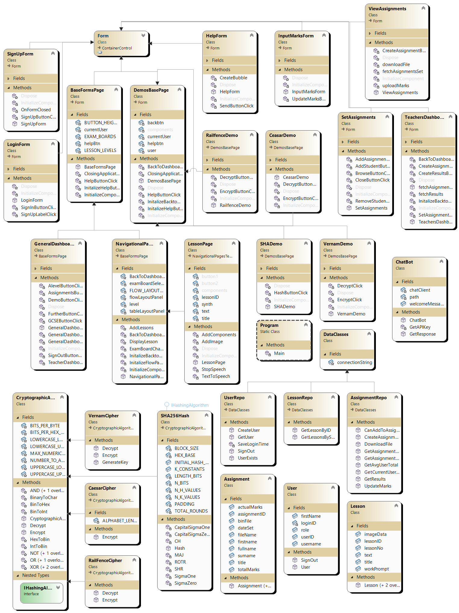

# Project overview
A Cryptography teaching tool written in C# with data stored and loaded dynamically using a local SQL server. This project was built for my AQA CS A level.
Please see the report for details on programming style and the applications architecture.

## Class Diagram

